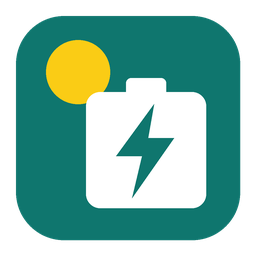

# Sofar Modbus

<p align="center">
  
</p>

<p align="center">
  <a href="https://hacs.xyz"></a>
  <a href="https://github.com/mimikm/HA-Sofar-Modbus/actions/workflows/validate.yml"></a>
  <a href="https://github.com/mimikm/HA-Sofar-Modbus/releases"></a>
  <a href="https://github.com/mimikm/HA-Sofar-Modbus/releases"></a>
  <a href="https://github.com/mimikm/HA-Sofar-Modbus/releases/latest"></a>
  <a href="https://www.buymeacoffee.com/mimikm"></a>
</p>

<p align="center">
  <a href="https://my.home-assistant.io/redirect/hacs_repository/?owner=mimikm&repository=HA-Sofar-Modbus&category=integration"></a>
</p>

Home Assistant integration for **Sofar Solar inverters** over an **RS485-to-Ethernet gateway** (Ebyte NE2-D14E, Waveshare RS485 TO ETH, …). Local polling, no cloud, no pymodbus dependency.

It **autodetects** what your inverter has and only creates the entities that exist: phases, PV inputs, battery inputs, hybrid controls.

## Supported inverters

| Family | Models | Status |
|---|---|---|
| Modern protocol (0x0400+) | HYD 3–6K-EP, HYD 5–20K-3PH, KTL-X G3 / KTLM (PV-only), ZCS Azzurro rebadges | Supported |
| Legacy storage protocol (0x0200+) | ME3000SP, HYD 3–6K-ES | **Beta** (v0.4) – testers wanted |

Tested on hardware: HYD 3680-EP. Other modern models are detected from the inverter's own channel configuration and address masks; please share a diagnostics download (below) if something looks wrong.

### ME3000SP / HYD-ES (beta)

These older inverters use a different register map and a non-standard Modbus command (function code 0x42) for battery control.

* Set the gateway to **transparent mode** and choose **RTU over TCP** in setup. Many gateways in Modbus TCP conversion mode drop function 0x42 – readings work, battery control doesn't.
* Set the inverter to **Passive mode** on its own display, otherwise it ignores battery commands.
* You get readings (grid, battery, load, PV on the HYD-ES, energy totals), **Battery action** (Auto, Force charge, Force discharge, Pause) and Home Assistant **charge/discharge slots**. Hold (no discharge) maps to Pause. The forced command is re-sent every poll.
* Not available on these models: passive set-points, native Timing / Time of use slots, inverter clock, remote on/off.

Have one? Please test and report in the [legacy testing issue](https://github.com/mimikm/HA-Sofar-Modbus/issues/1) with a diagnostics download.

### How detection works

1. Protocol family: the modern map answers at `0x0404`, the legacy ME3000SP / HYD-ES map at `0x0200`.
2. The inverter's input-channel config (`0x1011–0x1020`) says which DC inputs are PV strings and which are batteries.
3. Live readings (L2 voltage, battery voltages) decide phases and battery count; the address mask at the start of each 64-register field fills in optional registers.
4. Setup shows what it found before adding the device. Press **Re-detect inverter** after a firmware update or adding a battery.

Upgrading from `sofar_hyd_ep` (v0.2 and earlier): remove the old integration and its folder, install this one and add the inverter again. Entity IDs change from `…sofar_hyd_ep…` to new ones under the `Sofar` device.

## Install

**HACS (recommended)**

1. HACS → ⋮ → **Custom repositories** → add `https://github.com/mimikm/HA-Sofar-Modbus`, category **Integration** (or use the button above).
2. Download **Sofar Modbus**, then restart Home Assistant.
3. **Settings → Devices & services → Add integration → Sofar Modbus.**

**Manual**

Copy `custom_components/sofar_modbus` into `/config/custom_components/` and restart Home Assistant.

## Gateway setup

| Setting | Value |
|---|---|
| Serial | 9600 baud, 8 data bits, no parity, 1 stop bit |
| Inverter Modbus address | 1 (check the inverter's display menu) |
| Network | TCP server, port 502 |

Pick the matching **Gateway protocol** when adding the integration:

* **Modbus TCP** – gateway is in Modbus TCP ↔ RTU conversion mode (recommended).
* **RTU over TCP** – gateway is in transparent / no-protocol mode.

If setup says "No answer from the inverter", try the other protocol option first, then check A/B wiring and the address.

Only one Modbus master should poll the inverter's RS485 port. Remove any other integration pointed at the same gateway.

## Entities

**Power (W):** PV, PV1, PV2, grid, grid import, grid export, battery, battery charge, battery discharge, house load, inverter AC, EPS.

**Battery:** SOC, SOH, cycles, voltage, current, temperature, reserve (from the inverter's depth of discharge).

**Energy (kWh, Energy-dashboard ready):** PV, house load, grid import, grid export, battery charge, battery discharge – today and lifetime.

**Diagnostics:** inverter clock and drift, inverter state, fault (with fault bits as attributes), temperatures, insulation resistance, grid voltage/current/frequency, serial, firmware.

**Controls:**

| Entity | What it does |
|---|---|
| Energy storage mode | Self use / Time of use / Timing / Passive / Peak shaving |
| Battery action | Auto (self use), Force charge, Force discharge, Pause battery, Hold (no discharge), Hold (no charge) |
| Battery action power | Power used by Force charge / Force discharge |
| Passive desired grid power, minimum / maximum battery power | Raw passive-mode set-points |
| Passive timeout + action | Inverter falls back if it hears nothing for N seconds |
| Inverter on | Remote on/off (disabled by default) |
| Sync inverter clock | Sets the inverter clock to Home Assistant's local time |

### Sign conventions

| Value | Positive | Negative |
|---|---|---|
| Grid power sensor | exporting | importing |
| Battery power sensor | charging | discharging |
| Passive desired grid power | importing | exporting |
| Passive battery min/max | charging | discharging |

## Charge / discharge time slots

There are two ways to schedule the battery. Pick one at a time: Home Assistant slots switch the inverter to Passive mode, native slots switch it to Timing or Time of use.

### Home Assistant slots (flexible)

`sofar_modbus.charge_slot` / `sofar_modbus.discharge_slot` – start, end, optional power, optional SOC limit, optional daily repeat. When the SOC limit is reached the battery holds (no discharge) until the slot ends; afterwards the inverter goes back to Auto (self use). Slots survive restarts. The **Slot schedule** sensor shows what's running and lists all slots; **Clear scheduled slots** removes them.

```yaml
# Cheap-rate charge to 90 % every night
service: sofar_modbus.charge_slot
data:
  start: "00:30"
  end: "04:30"
  power: 3000
  soc: 90
  daily: true
```

```yaml
# Discharge for an export event today, stop at 20 %
service: sofar_modbus.discharge_slot
data:
  start: "16:00"
  end: "19:00"
  power: 3000
  soc: 20
```

Needs Home Assistant running – set a passive timeout if you want the inverter to fall back when it isn't.

### Native inverter slots (runs on the inverter)

* **Timing mode** – 4 slots, each with a charge window and a discharge window and their own power. Slot 1 has entities (times, powers, enable switches) and an **Apply timing slot 1** button; all 4 via `sofar_modbus.set_timing_slot`.
* **Time of use** – charge rules with a window, target SOC, power and weekdays. Rule 1 has entities and an **Apply time of use rule 1** button; rules 1–4 via `sofar_modbus.set_tou_rule`.

Applying writes the rule in one Modbus frame, commits it, checks the inverter's status reply, reads it back to verify, then switches the energy storage mode. These settings are stored in the inverter's EEPROM, so don't rewrite them from frequent automations.

## Predbat

Predbat can plan and control your Sofar battery through this integration – no automations needed. See the **[Predbat guide](predbat/README.md)** and the ready-made **[apps.yaml](predbat/apps.yaml)**.

## Diagnostics

**Settings → Devices & services → Sofar Modbus → ⋮ → Download diagnostics** gives the detected profile, polling state and a full register dump (gateway IP and serial redacted). Attach it to an issue to get a new model supported.

## Services

* `sofar_modbus.battery_action` – `action`, optional `power` and `target_soc` (charge/discharge stops at that SOC, then holds). Accepts `device_id` or `config_entry_id` for multiple inverters.
* `sofar_modbus.set_passive` – `grid_power`, `battery_min`, `battery_max`. All three are written together in one Modbus frame, then the inverter is switched to passive mode.
* `sofar_modbus.scan_registers` – reads every documented register range (or `start` + `count`) and saves a dump to `/config/sofar_register_scan_<time>.txt`. Use it to find registers your firmware supports that aren't mapped yet.

```yaml
# Force charge at 2.5 kW
service: sofar_modbus.battery_action
data:
  action: Force charge
  power: 2500
```

## Options

* **Polling interval** – default 10 s.
* **Maximum battery power** – default 3000 W; caps the action power and sliders.
* **Battery capacity** – kWh; enables Battery stored energy and Battery capacity sensors (used by Predbat).
* **Keep inverter clock in sync** – auto-corrects drift over 30 s, at most once an hour.
* **Re-send passive set-points every poll** – turn on together with a passive timeout, so the inverter falls back safely if Home Assistant stops.

## Notes

* Register map: Sofar "Modbus Protocol – General, valid for HYD 5…20K-3PH and HYD 3…6K-EP". Passive-mode layout (0x1187 grid, 0x1189 min, 0x118B max, I32) matches what evcc and solax_modbus use on real hardware.
* Writes use function 0x10 only, as the protocol document specifies.
